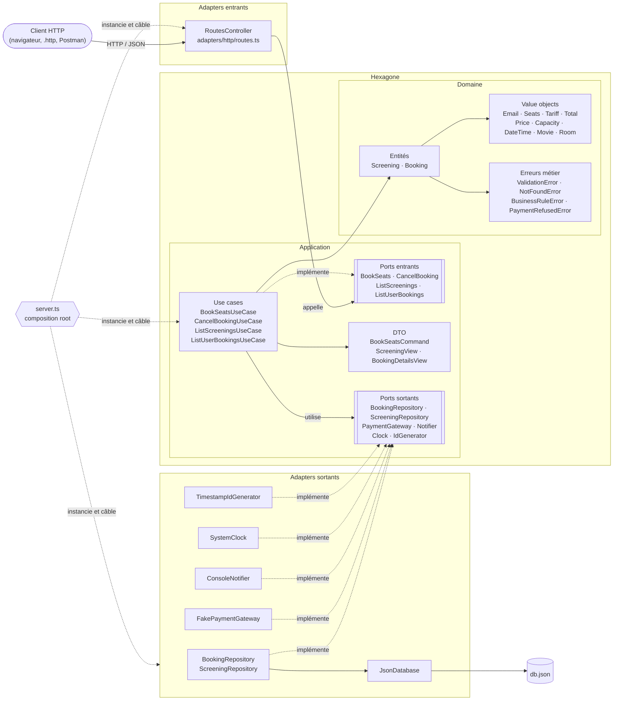
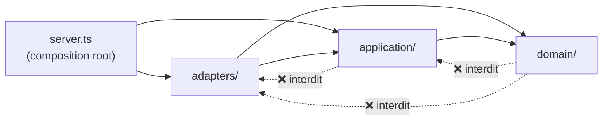
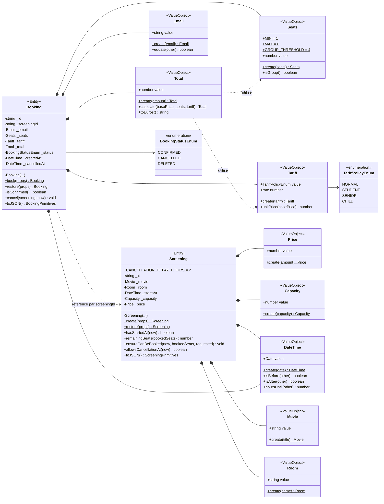
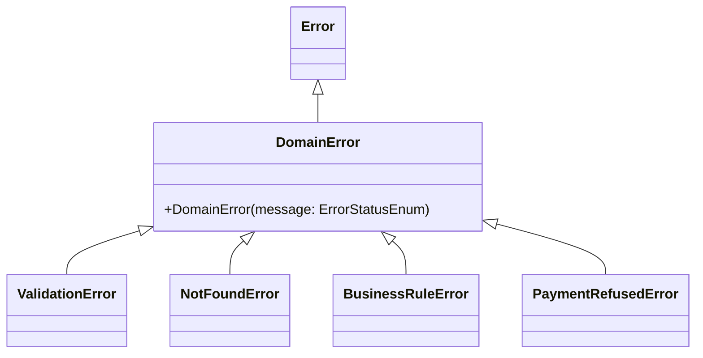
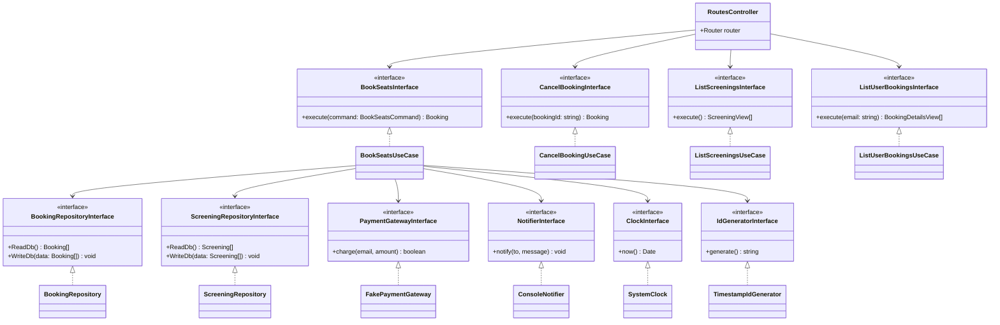
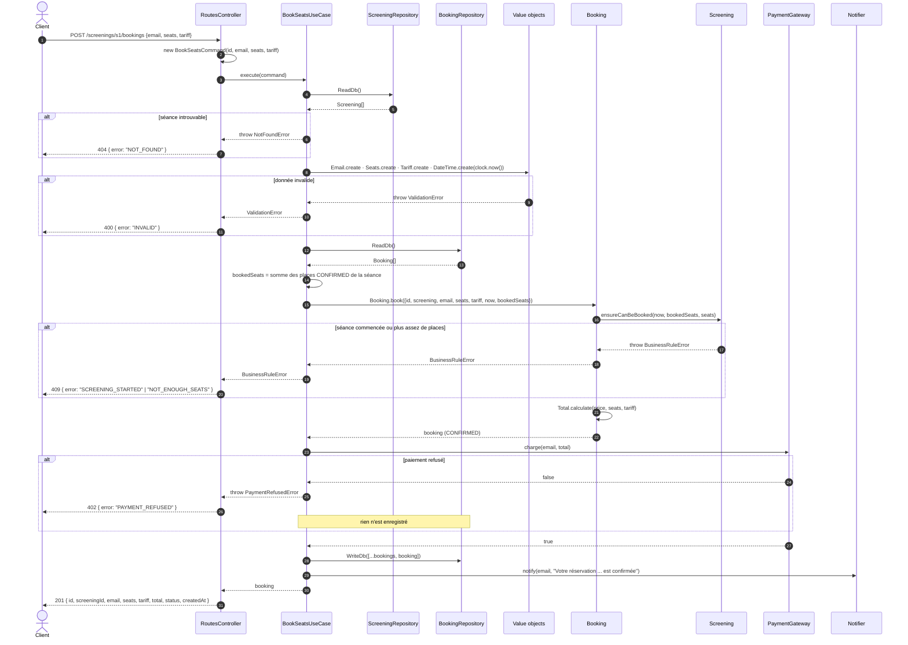
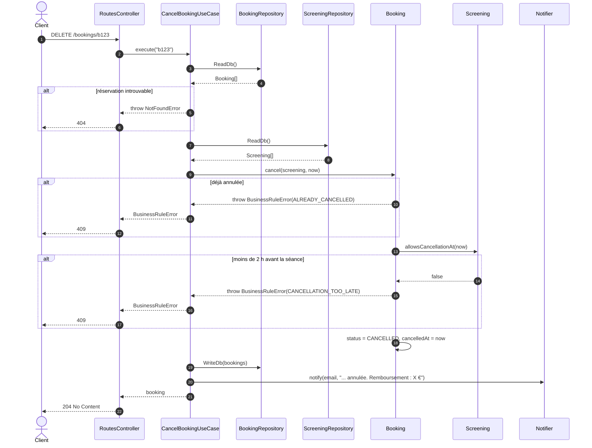
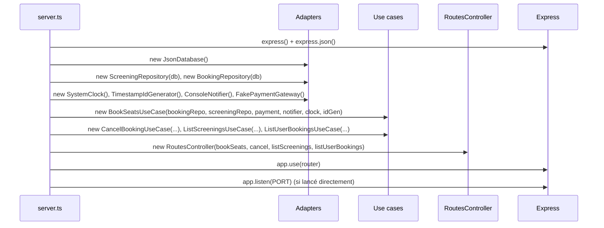
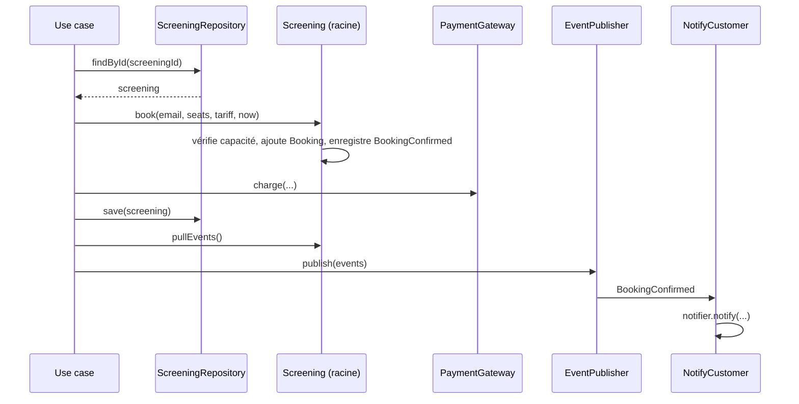

# Document d'Architecture Technique — CinéResa

| | |
| --- | --- |
| **Projet** | CinéResa — API de réservation de places de cinéma |
| **Contexte** | Module DDD / Architecture hexagonale — Ynov B3 |
| **Code concerné** | [`cineresa/`](../cineresa) (version refactorée) — [`cineresa-legacy/`](../cineresa-legacy) sert de référence fonctionnelle |
| **Branche de référence** | `dev` |
| **Version du document** | 1.0 — 09/11/2026 |

---

## Sommaire

1. [Objet du document](#1-objet-du-document)
2. [Contexte et périmètre fonctionnel](#2-contexte-et-périmètre-fonctionnel)
3. [Choix techniques](#3-choix-techniques)
4. [Architecture logicielle](#4-architecture-logicielle)
5. [Modèle du domaine (diagramme de classes)](#5-modèle-du-domaine-diagramme-de-classes)
6. [Cinématique (diagrammes de séquence)](#6-cinématique-diagrammes-de-séquence)
7. [Contrat d'API HTTP](#7-contrat-dapi-http)
8. [Persistance des données](#8-persistance-des-données)
9. [Gestion des erreurs](#9-gestion-des-erreurs)
10. [Stratégie de tests](#10-stratégie-de-tests)
11. [Installation et utilisation](#11-installation-et-utilisation)
12. [Dette technique et évolutions](#12-dette-technique-et-évolutions)
13. [Glossaire](#13-glossaire)

---

## 1. Objet du document

Ce document décrit l'architecture technique de CinéResa : les choix de technologies, l'organisation du code en architecture hexagonale (ports & adapters), le modèle du domaine issu de la démarche DDD, les flux principaux, et la manière d'installer, lancer et tester l'application.

Il s'adresse aux membres de l'équipe et aux évaluateurs du module, et sert de point d'entrée pour comprendre le code de [`cineresa/src`](../cineresa/src).

## 2. Contexte et périmètre fonctionnel

CinéResa part d'une application **legacy** où toute la logique tenait dans un seul fichier `server.ts` (routes, règles métier, accès fichier, envoi d'e-mails mélangés). Les TP successifs l'ont refactorée :

| Étape | Objectif |
| --- | --- |
| TP1 | Audit du legacy, graphe de dépendances ([`tp1/AUDIT.md`](../tp1/AUDIT.md)) |
| TP2 | Découpage en couches, ports & adapters, test d'architecture |
| TP3 | Use cases, DTO, adapters de persistance JSON |
| TP4 | DDD tactique : value objects, entités, agrégat (en cours) |

**Contrainte forte :** le contrat HTTP doit rester **identique** au legacy (mêmes routes, mêmes corps, mêmes codes d'erreur).

### Cas d'utilisation

| Use case | Description |
| --- | --- |
| Lister les séances | Séances à venir avec le nombre de places restantes |
| Réserver des places | 1 à 6 places sur une séance non commencée, avec paiement |
| Annuler une réservation | Possible jusqu'à 2 h avant le début de la séance, avec remboursement |
| Lister mes réservations | Réservations d'un client à partir de son e-mail |

### Règles métier

| Règle | Où elle vit |
| --- | --- |
| E-mail valide, normalisé en minuscules | VO `Email` |
| Entre 1 et 6 places par réservation | VO `Seats` |
| Tarifs : NORMAL ×1, STUDENT ×0,7, SENIOR ×0,9, CHILD ×1 ; tarif inconnu → NORMAL | VO `Tariff` |
| Remise de groupe de 10 % dès 4 places | VO `Total` (`Seats.isGroup()`) |
| Montants en centimes, entiers, jamais négatifs | VO `Price`, `Total` |
| Pas de réservation si la séance a commencé | Entité `Screening.ensureCanBeBooked` |
| Pas de dépassement de capacité | Entité `Screening.ensureCanBeBooked` |
| Pas de double annulation | Entité `Booking.cancel` |
| Annulation refusée à moins de 2 h de la séance | `Screening.allowsCancellationAt` |
| Paiement refusé → rien n'est enregistré | Use case `BookSeatsUseCase` |

## 3. Choix techniques

| Domaine | Choix | Version | Justification |
| --- | --- | --- | --- |
| Langage | **TypeScript** (mode `strict`) | — | Typage fort indispensable pour exprimer les ports (interfaces) et les value objects ; détection des erreurs à la compilation |
| Runtime | **Node.js** | ≥ 20 (testé en 26) | Écosystème du legacy, conservé |
| Framework HTTP | **Express** | 4.22 | Repris du legacy ; il est cantonné à un **adapter** (`adapters/http`), donc remplaçable sans toucher au métier |
| Exécution | **tsx** | 4.23 | Exécute le TypeScript sans étape de build ; mode `watch` pour le dev |
| Tests | **Vitest** | 5.0 | Rapide, compatible TypeScript sans config, résout les mêmes alias que `tsconfig` |
| Tests HTTP | **Supertest** | 7.3 | Teste l'app Express sans ouvrir de port (`server.ts` exporte `app`) |
| Configuration | **dotenv** | — | Chemin du fichier de données via `DB_FILE` dans `.env` |
| Persistance | **Fichier JSON** | — | Simple et suffisant pour le TP ; isolé derrière un port, donc remplaçable (SQL, mémoire…) |
| Modules | `nodenext` + alias `@domain/*`, `@application/*`, `@adapters/*` | — | Imports lisibles, et le test d'architecture s'appuie dessus pour vérifier le sens des dépendances |

### Choix d'architecture

| Choix | Pourquoi |
| --- | --- |
| **Architecture hexagonale** | Le métier ne dépend d'aucune technologie : on peut tester le domaine sans Express ni fichier, et changer un adapter sans toucher aux règles |
| **DDD tactique** | Les règles vivent dans les objets (VO, entités) au lieu d'être dispersées dans des `if` des services |
| **Value objects auto-validés** | Impossible de créer un e-mail invalide ou un montant négatif : la validation se fait une seule fois, à la construction |
| **Constructeurs privés + factories** | `create()` / `book()` pour une création métier, `restore()` pour la reconstitution depuis la persistance |
| **Injection de dépendances manuelle** | Tout est câblé dans `server.ts` (composition root), sans framework d'injection : explicite et suffisant |
| **Horloge et générateur d'id en ports** | Rend le temps et les identifiants maîtrisables dans les tests |
| **Test d'architecture automatisé** | Les règles de dépendances sont vérifiées à chaque `npm test`, pas seulement en revue de code |

## 4. Architecture logicielle

### 4.1 Vue hexagonale

Le cœur (domaine + application) ne connaît que des **interfaces** (ports). Les **adapters** implémentent ces ports ou les appellent. Les dépendances pointent toujours **vers l'intérieur**.



### 4.2 Règles de dépendances



Ces règles sont vérifiées par [`src/tests/architecture.test.ts`](../cineresa/src/tests/architecture.test.ts) :

- le domaine n'importe ni `application/`, ni `adapters/`, ni aucune librairie externe ;
- l'application n'importe ni les adapters, ni `express`, `fs`, `path`, `dotenv`, `http` ;
- les ports ne dépendent pas des use cases ; les DTO ne dépendent ni des ports ni des use cases ;
- chaque use case implémente un port entrant ;
- les adapters passent par les ports et ne dépendent pas les uns des autres ;
- seul `server.ts` instancie les use cases ;
- aucun cycle d'import.

### 4.3 Organisation des dossiers

```
cineresa/
├── src/
│   ├── server.ts                  Composition root : instancie et câble tout
│   ├── domain/                    Cœur métier, sans dépendance externe
│   │   ├── models/
│   │   │   ├── Entity/            Screening, Booking
│   │   │   ├── ValueObject/       Email, Seats, Tariff, Total, Price, Capacity, DateTime, Movie, Room
│   │   │   └── Enums/             BookingStatus, ErrorStatus, TariffPolicy, TariffRules
│   │   ├── errors/                DomainError et ses sous-classes
│   │   ├── utils/                 PriceCalculator (fonction pure) + fichiers de ré-export
│   │   └── tests/                 Tests unitaires du domaine
│   ├── application/
│   │   ├── ports/in/              Contrats exposés aux adapters entrants
│   │   ├── ports/out/             Contrats que l'application attend de l'extérieur
│   │   ├── usecases/              Orchestration d'un cas d'utilisation
│   │   └── dto/                   Objets d'entrée (Command) et de sortie (View)
│   ├── adapters/
│   │   ├── http/                  Express : routes + traduction erreurs → codes HTTP
│   │   ├── data/                  JsonDatabase + repositories + db.json
│   │   ├── payment/               FakePaymentGateway
│   │   ├── notification/          ConsoleNotifier
│   │   ├── clock/                 SystemClock
│   │   └── id/                    TimestampIdGenerator
│   └── tests/                     Test d'architecture
├── scripts/seed.ts                Génération de données de démo
├── testhttp/testreq.http          Requêtes HTTP prêtes à l'emploi
├── tsconfig.json                  Mode strict + alias
└── vitest.config.ts               Mêmes alias que tsconfig
```

### 4.4 Rôle de chaque couche

| Couche | Responsabilité | Ne doit **pas** |
| --- | --- | --- |
| **Domaine** | Porter les règles métier et les invariants (validation, capacité, délai d'annulation, calcul du prix) | Connaître HTTP, le fichier JSON, l'heure système ou le paiement |
| **Application** | Orchestrer : charger, appeler le domaine, payer, sauvegarder, notifier | Contenir des règles métier, importer Express ou `fs` |
| **Adapters** | Traduire entre le monde extérieur et les ports (HTTP ↔ Command, JSON ↔ entités) | Contenir des règles métier, appeler un use case concret |
| **Composition root** | Instancier les adapters et les use cases, injecter les dépendances | Contenir de la logique |

## 5. Modèle du domaine (diagramme de classes)

### 5.1 Entités et value objects



> `Booking` référence sa séance **par identifiant** (`screeningId`), pas par l'objet : chaque entité reste indépendante et se persiste séparément. Les méthodes qui ont besoin de la séance (`book`, `cancel`) la reçoivent en paramètre.

### 5.2 Erreurs du domaine



### 5.3 Application : ports, use cases et adapters



## 6. Cinématique (diagrammes de séquence)

### 6.1 Réserver des places — `POST /screenings/:id/bookings`



### 6.2 Annuler une réservation — `DELETE /bookings/:id`



### 6.3 Démarrage de l'application (composition root)



## 7. Contrat d'API HTTP

Base : `http://localhost:3000`. Tous les montants sont en **centimes**.

| Méthode | Route | Corps / paramètres | Succès | Erreurs |
| --- | --- | --- | --- | --- |
| GET | `/screenings` | — | `200` liste des séances à venir | `500` |
| POST | `/screenings/:id/bookings` | `{ "email": "a@b.fr", "seats": 2, "tariff": "NORMAL" }` | `201` réservation créée | `400`, `402`, `404`, `409` |
| DELETE | `/bookings/:id` | — | `204` | `404`, `409` |
| GET | `/bookings?email=a@b.fr` | `email` en query | `200` réservations du client | `500` |

`tariff` accepte `NORMAL`, `STUDENT`, `SENIOR`, `CHILD`. Toute autre valeur (ou absence) est traitée comme `NORMAL`.

**Exemple — séance (`GET /screenings`)**

```json
{
  "id": "s1",
  "movie": "Dune: Part Three",
  "room": "Salle 1",
  "seats": 120,
  "capacity": 120,
  "startsAt": "2026-11-10T10:28:03.002Z",
  "price": 1150,
  "remaining": 118
}
```

**Exemple — réservation créée (`POST`)**

```json
{
  "id": "b1762685283002",
  "screeningId": "s1",
  "email": "a@b.fr",
  "seats": 2,
  "tariff": "NORMAL",
  "total": 2300,
  "status": "CONFIRMED",
  "createdAt": "2026-11-09T10:28:03.002Z"
}
```

`GET /bookings` renvoie le même objet enrichi de `movie` et `startsAt` (DTO `BookingDetailsView`).

## 8. Persistance des données

- Un fichier JSON unique ([`src/adapters/data/db.json`](../cineresa/src/adapters/data/db.json)) contient deux tableaux : `screenings` et `bookings`.
- `JsonDatabase` lit et écrit le fichier entier ; son chemin vient de la variable `DB_FILE` (par défaut `./src/adapters/data/db.json`).
- Chaque repository traduit entre le JSON et les entités :
  - lecture : `Screening.restore(json)` / `Booking.restore(json)` (les VO revalident les données) ;
  - écriture : `entity.toJSON()` (forme « primitive » : `ScreeningPrimitives`, `BookingPrimitives`).
- Le domaine ignore tout de ce format : passer à une base SQL ou à un stockage en mémoire ne demande qu'un nouvel adapter implémentant le même port.

## 9. Gestion des erreurs

Le domaine lève des erreurs **métier** typées ; seul l'adapter HTTP les traduit en codes HTTP (`RoutesController.handleError`).

| Erreur du domaine | Code HTTP | Messages possibles |
| --- | --- | --- |
| `ValidationError` | 400 | `INVALID` |
| `PaymentRefusedError` | 402 | `PAYMENT_REFUSED` |
| `NotFoundError` | 404 | `NOT_FOUND` |
| `BusinessRuleError` | 409 | `SCREENING_STARTED`, `NOT_ENOUGH_SEATS`, `ALREADY_CANCELLED`, `CANCELLATION_TOO_LATE` |
| Autre | 500 | `INTERNAL_ERROR` (détail loggé côté serveur) |

## 10. Stratégie de tests

| Type | Fichier | Ce qui est vérifié |
| --- | --- | --- |
| Unitaire domaine | [`domain/tests/PriceCalculator.test.ts`](../cineresa/src/domain/tests/PriceCalculator.test.ts) | Tarifs, tarif par défaut, remise de groupe, arrondis, cas limites |
| Architecture | [`tests/architecture.test.ts`](../cineresa/src/tests/architecture.test.ts) | Sens des dépendances entre couches, absence de cycles, composition root |
| Manuel HTTP | [`testhttp/testreq.http`](../cineresa/testhttp/testreq.http) | Scénario complet via l'extension REST Client |

Grâce aux ports, les use cases se testent avec des doublures (`Clock` figée, `PaymentGateway` qui refuse, repository en mémoire) sans fichier ni réseau.

**État au 09/11/2026 :** 33 tests sur 34 passent. Le test « le domaine ne dépend pas de la couche application » échoue (voir [§12](#12-dette-technique-et-évolutions)).

## 11. Installation et utilisation

### Prérequis

- Node.js 20 ou plus, npm

### Installation

```bash
cd cineresa
npm install
```

Créer un fichier `.env` (non versionné) :

```env
DB_FILE="./src/adapters/data/db.json"
PORT=3000            # optionnel
```

### Commandes

| Commande | Effet |
| --- | --- |
| `npm start` | Lance l'API sur `http://localhost:3000` |
| `npm run dev` | Lance l'API avec rechargement automatique |
| `npm test` | Lance tous les tests (unitaires + architecture) |
| `npm run typecheck` | Vérifie les types sans compiler |
| `npm run seed` | Génère des séances de démo dans les prochains jours |

### Essayer l'API

```bash
curl http://localhost:3000/screenings

curl -X POST http://localhost:3000/screenings/s1/bookings \
  -H "Content-Type: application/json" \
  -d '{"email":"a@b.fr","seats":2,"tariff":"STUDENT"}'

curl "http://localhost:3000/bookings?email=a@b.fr"

curl -X DELETE http://localhost:3000/bookings/<id>
```

Ou ouvrir [`testhttp/testreq.http`](../cineresa/testhttp/testreq.http) dans VS Code avec l'extension REST Client.

> Le paiement est simulé : `FakePaymentGateway` refuse environ 1 paiement sur 20 (réponse `402`).

## 12. Dette technique et évolutions

### Points à corriger

| # | Constat | Impact | Correction proposée |
| --- | --- | --- | --- |
| 1 | `domain/utils/interface.ts` et `domain/utils/HTTPException.ts` importent des ports de `application/` | Fait échouer le test d'architecture ; le domaine dépend de l'application | Supprimer ces fichiers de ré-export ou les déplacer dans `application/` |
| 2 | `domain/models/objects/` (`BookingDto`, `BookingDetailsDto`) doublonne `application/dto/` | Code mort, confusion sur la place des DTO | Supprimer, les DTO vivent dans `application/dto` |
| 3 | `PriceCalculator` et `Total.calculate` contiennent la même règle de prix | Risque de divergence | Faire de l'un un appel à l'autre (ou un domain service `PricingPolicy`, TP4) |
| 4 | Les ports entrants `BookSeats` et `CancelBooking` renvoient l'entité `Booking` | Un objet du domaine sort de l'hexagone | Renvoyer un DTO (`BookingView`) |
| 5 | `JsonDatabaseInterface` est rangé dans `ports/in` | C'est un besoin sortant | Le déplacer dans `ports/out` ou en détail interne de l'adapter `data/` |
| 6 | La capacité est vérifiée avec un `bookedSeats` calculé dans le use case | L'invariant n'est pas protégé par une racine d'agrégat | `Screening` racine d'agrégat contenant ses `Booking` (TP4) |
| 7 | `scripts/seed.ts` écrit dans `src/data/db.json` alors que l'app lit `src/adapters/data/db.json` | Le seed n'a pas d'effet visible | Aligner le chemin sur `DB_FILE` |
| 8 | `JsonDatabase.readDb()` fait un `console.log` à chaque lecture | Bruit dans les logs | Retirer |
| 9 | `TimestampIdGenerator` (`"b" + Date.now()`) | Collision possible si deux réservations la même milliseconde | `crypto.randomUUID()` |
| 10 | Lecture/écriture du fichier complet, sans verrou | Écritures concurrentes perdues | Acceptable en TP ; une vraie base en production |
| 11 | `package.json` s'appelle encore `cineresa-legacy`, `typescript` n'est pas déclaré en devDependency | Confusion, `typecheck` dépend d'une version transitive | Renommer, ajouter `typescript` |
| 12 | `BookingStatusEnum.DELETED` jamais utilisé | Code mort | Supprimer ou documenter |

### Évolutions prévues (TP4)

- **Value objects** `Money`, `Email`, `SeatCount` conformes aux tests fournis.
- **Domain service** `PricingPolicy` pour le calcul du prix.
- **Agrégat** : `Screening` devient racine, contient ses `Booking`, expose `book()`, `cancel()`, `remainingSeats()` ; un seul `ScreeningRepository`.
- **Domain events** `BookingConfirmed` / `BookingCancelled`, publiés après sauvegarde via un `EventPublisher` ; un handler `NotifyCustomer` envoie les e-mails (les use cases n'appellent plus le notifier).



## 13. Glossaire

| Terme | Définition |
| --- | --- |
| **Architecture hexagonale** | Organisation où le métier est au centre et communique avec l'extérieur uniquement via des ports (interfaces) |
| **Port entrant** | Interface qu'un adapter entrant (HTTP) appelle pour déclencher un cas d'utilisation |
| **Port sortant** | Interface dont l'application a besoin (persistance, paiement…) et qu'un adapter implémente |
| **Adapter** | Implémentation technique d'un port (Express, fichier JSON, console…) |
| **Composition root** | Unique endroit où l'on instancie et assemble les objets (`server.ts`) |
| **Value object** | Objet immuable défini par sa valeur, validé à la construction (`Email`, `Seats`) |
| **Entité** | Objet métier doté d'une identité et d'un cycle de vie (`Booking`, `Screening`) |
| **Agrégat / racine** | Groupe d'objets cohérent dont une seule entité (la racine) est la porte d'entrée et garantit les invariants |
| **Use case** | Orchestration d'un scénario utilisateur, sans règle métier propre |
| **DTO** | Objet de transport de données en entrée (Command) ou en sortie (View) de l'application |
| **Domain event** | Fait métier passé (« réservation confirmée ») auquel d'autres parties réagissent |
