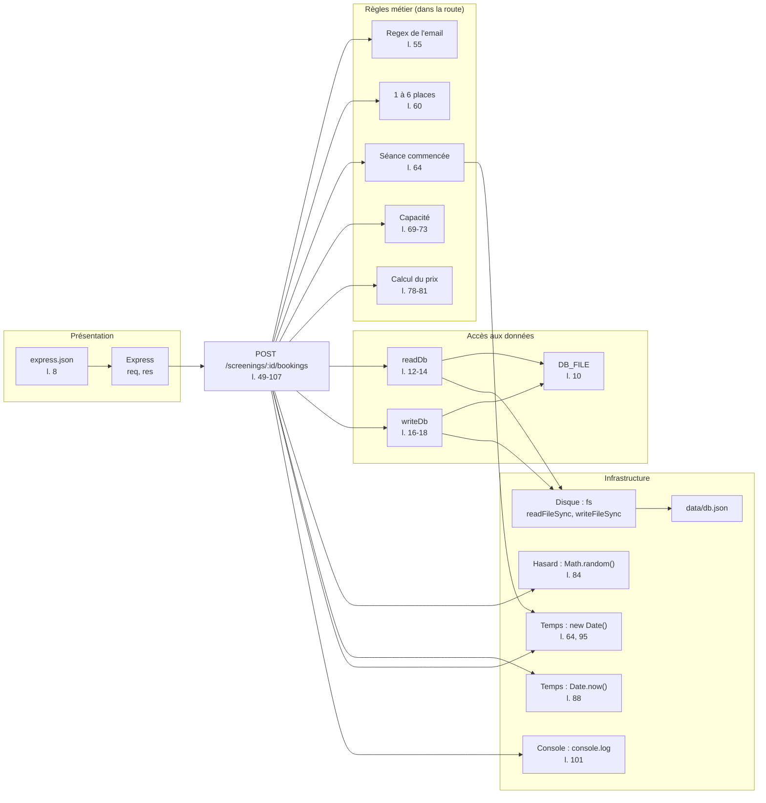

# AUDIT LEGACY

Les numéros de lignes renvoient à `cineresa-legacy/src/server.ts`.

## Cartographie

| Lignes | Bloc | Présentation (HTTP) | Règle métier | Accès aux données | Infrastructure (mail, paiement, temps) |
| --- | --- | --- | --- | --- | --- |
| 7-8 | Initialisation d'Express | Application et parsing JSON | | | |
| 10 | Chemin de la base | | | Chemin de `db.json` | |
| 12-14 | `readDb` | | | Lecture du fichier JSON | |
| 16-18 | `writeDb` | | | Écriture du fichier JSON | |
| 23 | GET `/screenings` : route | Déclaration de la route | | | |
| 24 | Chargement de la base | | | `readDb()` | |
| 25-28 | Filtre des séances à venir | | Exclure les séances passées | | Temps : `new Date()` |
| 29-32 | Calcul des places prises | | Somme des places `CONFIRMED` | | |
| 33-42 | Réponse | Format JSON et `res.json` | Places restantes (l. 39) | | |
| 49 | POST `/screenings/:id/bookings` : route | Déclaration de la route | | | |
| 50-51 | Recherche de la séance | Lecture de `req.params` | | `readDb()` | |
| 52 | Séance absente | 404 | Séance inexistante | | |
| 54-57 | Validation de l'email | Lecture de `req.body`, 400 | Format de l'email | | |
| 59-62 | Validation des places | Lecture de `req.body`, 400 | 1 à 6 places | | |
| 64-66 | Séance commencée | 409 | Réservation impossible après le début | | Temps : `new Date()` |
| 68-75 | Capacité | 409 | Ne pas dépasser la capacité de la salle | | |
| 77-81 | Calcul du prix | Lecture de `req.body.tariff` | Étudiant -30 %, groupe -10 % dès 4 places | | |
| 83-85 | Paiement | 402 | Refus de la réservation si impayée | | Paiement simulé : `Math.random()` |
| 87-96 | Création de la réservation | Lecture de `req.body.tariff` | Statut initial, tarif retenu | | Temps : `Date.now()`, `new Date()` |
| 97-98 | Sauvegarde | | | `writeDb()` | |
| 100-104 | Mail de confirmation | | Contenu du message | | Mail simulé : `console.log` |
| 106 | Réponse | 201 et `res.json` | | | |
| 112 | DELETE `/bookings/:id` : route | Déclaration de la route | | | |
| 113-114 | Recherche de la réservation | Lecture de `req.params` | | `readDb()` | |
| 115-116 | Réservation absente ou déjà annulée | 404, 409 | Annulation unique | | |
| 118 | Recherche de la séance | | | Parcours de `db.screenings` | |
| 119-122 | Délai d'annulation | 409 | Annulation jusqu'à 2 h avant | | Temps : `new Date()` |
| 124-125 | Changement de statut | | Passage à `CANCELLED` | | Temps : `new Date()` |
| 126 | Sauvegarde | | | `writeDb()` | |
| 128 | Mail d'annulation | | Contenu du message | | Mail simulé : `console.log` |
| 129 | Réponse | `res.json` | | | |
| 135 | GET `/bookings` : route | Déclaration de la route | | | |
| 136-137 | Réservations du client | Lecture de `req.query` | Filtre par email | `readDb()` | |
| 138-143 | Réponse enrichie | Format JSON et `res.json` | Valeurs par défaut si séance absente | Parcours de `db.screenings` | |
| 146-149 | Lancement du serveur | Écoute du port | | | Variable d'environnement, `console.log` |
| 151 | Export de l'application | Export de `app` | | | |

`seed.ts` ⇒ Init de la base de donnée (création du fichier, création de donnée)

## Code smells

| Smell | Lignes | Conséquence concrète |
| --- | --- | --- |
| Fonction trop longue (God Function) | 49-107 | HTTP, validation, prix, paiement, sauvegarde et mail sont mêlés : modifier un tarif oblige à relire toute la route, et le prix ne peut pas être testé seul. |
| Code dupliqué | 29-32 et 69-72 | Si le comptage des places change, oublier une copie fait annoncer par `GET /screenings` des places que `POST` refuse. |
| Nombres magiques | 60, 79, 81, 84, 120 | `1`, `6`, `0.7`, `4`, `0.9`, `0.05` et `2 * 60 * 60 * 1000` n'ont pas de nom : le sens de la règle se devine et chaque changement impose de retrouver les valeurs à la main. |
| Chaînes magiques | 31, 71, 94, 116, 124 (statuts) ; 79, 92 (tarifs) | Une faute de frappe comme `"CANCELED"` compile sans erreur et fausse silencieusement les filtres. |
| Absence de typage (`any`) | 12, 16, 51, 114, 137, 139, 140 | Un champ mal orthographié (`s.capcity`) compile et donne `undefined` ou `NaN` à l'exécution. |
| Chemin de base codé en dur | 10 | Impossible de pointer vers une autre base : un test de la route lit et écrit le vrai `data/db.json`. |
| Erreurs d'accès au fichier non gérées | 13, 17 | Un JSON corrompu ou un fichier absent donne une page d'erreur HTML 500 au lieu d'un JSON, et arrête le processus sur `POST`, dont le handler `async` laisse la promesse rejetée sans traitement. |
| Accès sans contrôle | 118-119 | Si la séance d'une réservation n'existe plus, `s.startsAt` lève une `TypeError` et le client reçoit un 500. |
| Dépendances globales cachées | 25, 64, 84, 88, 95, 101, 119, 125, 128 | L'heure, le hasard et la console sont appelés directement : le résultat d'un test dépend de l'instant et d'un tirage aléatoire. |

## Erreur SOLID

### Single Responsibility Principle

- La fonction `/screenings/:id/bookings` (49-107) gère plusieurs responsabilités :

    - Accès aux données
    - Validation des entrées
    - Règles métiers
    - Calcul du prix
    - Paiement
    - Création de l'entité
    - Notification par email
    - Gestion des codes HTTP

- La fonction `/bookings/:id` (112-130) gère l'annulation, le changement d'état, la sauvegarde et les emails.
- `/screenings` (23-43) gère le filtrage temporel, le calcul des places restantes et le format de la réponse.

### Open/Closed Principle

- Les règles de tarification sont codées en dur dans la route (79, 81) : ajouter un tarif `SENIOR` oblige à modifier le handler. Il faudrait pouvoir ajouter un tarif sans y toucher, par exemple avec une stratégie de tarification (PricingPolicy polymorphe).
- Le paiement est écrit directement dans la route (84) : brancher Stripe oblige aussi à modifier le handler.

### Liskov Substitution Principle

Ne s'applique pas ici : le legacy ne contient ni héritage, ni interface, ni implémentations interchangeables. Il n'y a donc aucun sous-type dont la substitution pourrait être incorrecte.

### Interface Segregation Principle

S'applique peu, car le legacy ne déclare aucune interface. Le cas le plus proche est `readDb()` (12-14) : elle donne à chaque route toute la base typée `any`, même pour consulter une seule séance. Chaque route dépend ainsi de l'ensemble du schéma.

### Dependency Inversion Principle

Les routes, qui portent les règles métier, dépendent directement des détails techniques, sans abstraction : `fs` (13, 17), `Math.random()` (84), `console.log` (101, 128) et `new Date()` (25, 64, 95, 119, 125).

## Graphe des dépendances de `POST /screenings/:id/bookings`

### Dépendances test unitaires

Il faut respecter le Dependency Inversion Principle pour remplacer une dépendance dans un test sans modifier le code. Dans le legacy, aucune dépendance n'est injectée : seules celles portées par un objet global ou un module peuvent être remplacées, et uniquement en les interceptant depuis le test.

| Dépendance | Peut-on la remplacer dans un test sans modifier le code ? |
| --- | --- |
| Express (`req`, `res`) | Non, mais on peut la piloter : `app` est exporté (l. 151), donc supertest envoie de vraies requêtes sans ouvrir de port. |
| `express.json` | Non, il est branché en dur sur `app` (l. 8). |
| Regex de l'email, règles de places, de capacité et de prix | Non, elles sont écrites dans la route. On ne peut les exercer qu'à travers une requête HTTP. |
| `readDb`, `writeDb` | Non, ce sont des fonctions internes au module, non exportées. |
| `DB_FILE` | Non, le chemin est calculé en dur (l. 10). |
| Disque (`fs`, `data/db.json`) | Pas par injection. Seule une interception du module avec `vi.mock("fs")` évite d'écrire dans le vrai fichier. |
| Temps (`new Date()`, `Date.now()`) | Pas par injection. Seule une horloge globale truquée avec `vi.useFakeTimers()` permet de le fixer. |
| Hasard (`Math.random()`) | Pas par injection. Seul `vi.spyOn(Math, "random")` permet de forcer le résultat du paiement. |
| Console (`console.log`) | Pas par injection. `vi.spyOn(console, "log")` permet de l'intercepter et de vérifier le message. |

## Bilan

Après le découpage (`tp1/cineresa-TP1`), voici ce qui change.

**Testable sans démarrer le serveur ni écrire dans `db.json` :**

- Le calcul du prix : `calculatePrice` est une fonction pure, couverte par `npm test`.
- Le calcul des places restantes : `remainingSeats` est une fonction pure, qui ne reçoit que la séance et les réservations.
- Les règles de `BookingService` et `ScreeningService` qui ne dépendent pas de l'heure, car les repositories, le mailer et le paiement sont passés au constructeur et peuvent être remplacés par de faux objets en mémoire : séance ou réservation introuvable, email invalide, 1 à 6 places, capacité dépassée, paiement refusé, double annulation, filtre des réservations par email.

**Impossible à tester sans modifier le code ou truquer une globale :**

- Les règles liées au temps : séance déjà commencée, annulation jusqu'à 2 h avant, filtre des séances à venir. Les services appellent `new Date()` directement : on ne peut pas décider de l'heure courante, seulement placer les dates des données de test par rapport à l'heure réelle, ce qui ne permet pas de vérifier précisément les limites comme « exactement 2 h avant ».
- Les valeurs exactes de `id`, `createdAt` et `cancelledAt` : elles viennent de `Date.now()` et `new Date()`, donc changent à chaque exécution.
- Le vrai `PaymentGateway` : `Math.random()` rend son résultat imprévisible. On peut le remplacer dans le service, mais pas tester son propre comportement de façon déterministe.
- La vraie persistance : `Utils` lit et écrit toujours un fichier. `DB_FILE` permet de viser un autre fichier, mais le test reste lié au disque.

**Pourquoi :** ces dépendances restent appelées directement, sans abstraction entre le métier et elles. L'heure en particulier n'est pas injectée, et `BookingService` dépend encore des classes concrètes de `data`. C'est la limite de l'architecture en couches, que le TP2 corrige en inversant les dépendances.
